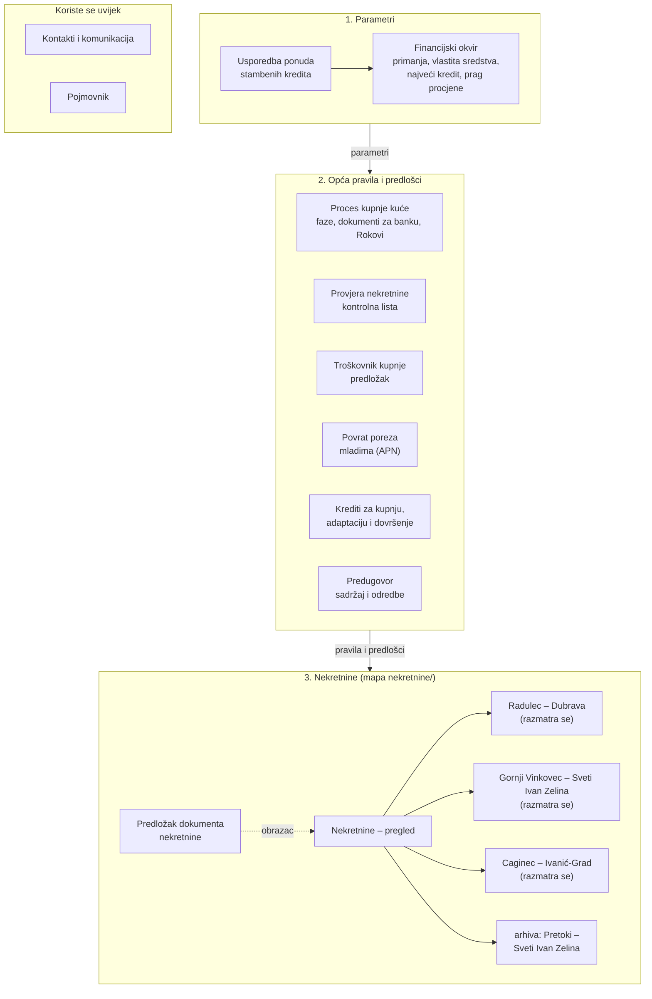
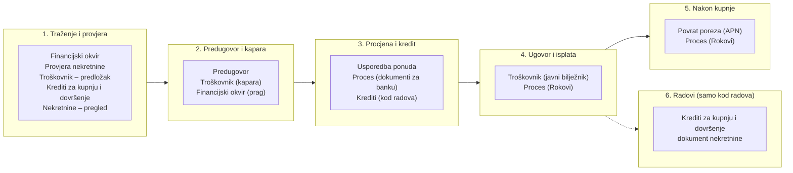

# Stambeni kredit – kupnja kuće

Bilješke, izračuni i dokumenti za kupnju kuće uz stambeni kredit: useljive kuće ili kuće koju treba adaptirati, rekonstruirati ili dovršiti. Stanje 3. 11. 2026.: tražimo nekretninu; kupnja u Pretokima je propala 22. 10. 2026., a razmatraju se kuće u Radulecu (Dubrava), Gornjem Vinkovcu i Cagincu.

Dokumenti su podijeljeni na **opće**, koji vrijede za svaku nekretninu (pravila, parametri, predlošci), i **dokumente nekretnina** u mapi `nekretnine/`, koji sadrže samo podatke i izračune za jednu nekretninu i upućuju na opće dokumente. Propale ili odbačene nekretnine su u `nekretnine/arhiva/` i više se ne ažuriraju.

## Opći dokumenti

| Dokument | Sadržaj |
| --- | --- |
| [Financijski okvir](Financijski%20okvir.md) | Primanja, vlastita sredstva, najveća rata, najveći kredit, najveća cijena, prag procjene |
| [Proces kupnje kuće – koraci i dokumenti](Proces%20kupnje%20ku%C4%87e%20%E2%80%93%20koraci%20i%20dokumenti.md) | Faze kupnje (i radova), dokumenti za banku, Rokovi |
| [Provjera nekretnine – kontrolna lista](Provjera%20nekretnine%20%E2%80%93%20kontrolna%20lista.md) | Što provjeriti za svaku nekretninu prije kapare |
| [Troškovnik kupnje – predložak](Tro%C5%A1kovnik%20kupnje%20%E2%80%93%20predlo%C5%BEak.md) | Svi troškovi kupnje, povoljno i nepovoljno; kapara; redoslijed plaćanja |
| [Povrat poreza mladima (APN)](Povrat%20poreza%20mladima%20%28APN%29.md) | Uvjeti i izračun povrata poreza na promet |
| [Krediti za kupnju, adaptaciju i dovršenje](Krediti%20za%20kupnju%2C%20adaptaciju%20i%20dovr%C5%A1enje.md) | Vrste radova, ponude banaka, okvirne cijene radova, rizici |
| [Predugovor – sadržaj i odredbe](Predugovor%20%E2%80%93%20sadr%C5%BEaj%20i%20odredbe.md) | Odredbe koje štite kaparu, analiza oglednog primjerka |
| [Usporedba ponuda stambenih kredita](Usporedba%20ponuda%20stambenih%20kredita.md) | Sve ponude banaka, CPI police, detalji HPB ponude |
| [Kontakti i komunikacija](Kontakti%20i%20komunikacija.md) | Kontakti i slijed komunikacije |
| [Pojmovnik](Pojmovnik.md) | Pravni, bankarski i građevinski pojmovi |

## Nekretnine

| Dokument | Sadržaj |
| --- | --- |
| [Nekretnine – pregled](nekretnine/Nekretnine%20%E2%80%93%20pregled.md) | Sve razmatrane nekretnine i njihov status |
| [Radulec – Dubrava](nekretnine/Radulec%20%E2%80%93%20Dubrava.md) | Kuća s useljivim prizemljem i potkrovljem za dovršenje: troškovi kupnje, budžet za radove |
| [Gornji Vinkovec – Sveti Ivan Zelina](nekretnine/Gornji%20Vinkovec%20%E2%80%93%20Sveti%20Ivan%20Zelina.md) | Useljiva kuća s planiranom adaptacijom: troškovi kupnje, budžet za preuređenje |
| [Caginec – Ivanić-Grad](nekretnine/Caginec%20%E2%80%93%20Ivani%C4%87-Grad.md) | Kuća u roh-bau stanju: trošak dovršetka, rizici, okvir |
| [Pretoki – Sveti Ivan Zelina](nekretnine/arhiva/Pretoki%20%E2%80%93%20Sveti%20Ivan%20Zelina.md) | Arhiva: useljiva kuća, kupnja propala 22. 10. 2026.; primjer cijelog izračuna |
| [Predložak dokumenta nekretnine](nekretnine/Predlo%C5%BEak%20dokumenta%20nekretnine.md) | Obrazac za novu nekretninu |

## Kako su dokumenti povezani

Dokumenti su u tri razine: na vrhu parametri (Financijski okvir, uz ponude iz kojih dolazi kamata), ispod njih opća pravila i predlošci, a na dnu dokumenti nekretnina koji ih primjenjuju na jednu kuću. Strelica pokazuje smjer u kojem podaci i pravila teku: promjena na višoj razini utječe na sve ispod nje. Kontakti i komunikacija i Pojmovnik koriste se uvijek.

## Koji je dokument kada bitan

Faze su iz dokumenta Proces kupnje kuće; ispod svake su dokumenti koji se u njoj najviše koriste. Faza 6 postoji samo kod kuće s radovima.

Upute za rad s Claudeom su u [CLAUDE.md](CLAUDE.md) i mapi [upute](upute/).
